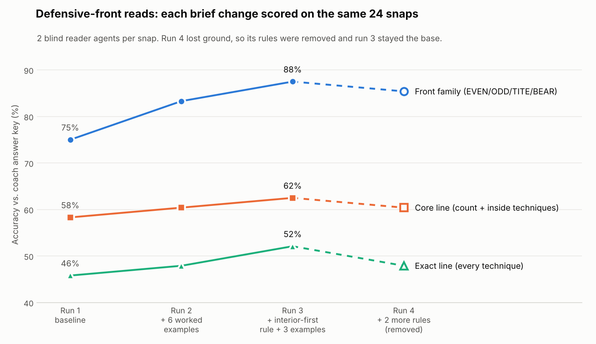
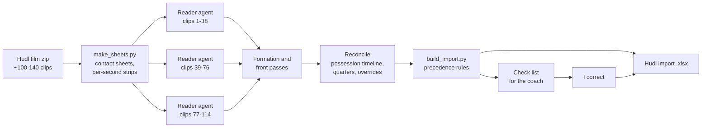

# AI film breakdown: parallel Claude agents tag game film, scored against a coach's answer key

High school football staffs spend hours each week tagging game film in Hudl, filling in down, distance, field
position, formation, defensive front and result for every snap. This repo is the workflow I built during the
2026 season to do the first pass automatically. It cuts the film into frames, splits the game across parallel
Claude reader agents, reconciles their reads into a Hudl import file, and hands me a short check list of the snaps
it isn't sure about. I coach high school football, so I'm both the builder and the user.

It tagged **about 980 snaps across nine games** in October 2026, covering our own games and opponent scouting film.

The part I'd point a reviewer to isn't the vision. It's the loop around it: an answer key I built by hand,
blind readers, a scoring script, and a rule that **a change to the agents' instructions stays only if the score
goes up.**

## How it works

1. **Frames.** `make_sheets.py` pulls six stamped frames per clip from the wide camera into a contact sheet, and
   `snap_strip.py` adds one frame per second so a reader can pick the moment the offense is set. About a minute
   per game.
2. **Parallel readers.** One agent per ~35-40 clips, each with the reader brief (`skill/reader_brief.md`), the
   team codes and jersey descriptions, and the three clips before its range for context. Each agent writes one
   JSON line per clip as it goes. A ~110-snap game finishes in roughly 15-20 minutes.
3. **Specialist passes.** A formation pass (`skill/formation_brief.md`) names every offensive snap in our own
   terminology, and a front pass (`skill/front_brief.md`) lists every defensive lineman's alignment.
4. **Reconcile and build.** Possession must make football sense: every series ends in a score, punt, turnover,
   downs or the half. `build_import.py` then merges sources in a fixed precedence (frame reads < agent
   overrides < Hudl Assist < my own tags < approved fixes) and writes a Hudl-ready import file with the
   same row count as the film.
5. **Check list, not a re-tag.** I get a short list of the snaps that change the scouting picture, review
   those, and my corrections win.

## Measuring it: the gold set

Early on, the agents' defensive-front calls were still well off my own reads. The fix was to measure, not to
add more adjectives to the prompt.

- **Answer key:** I checked every defensive front on one opponent's film by hand (104 snaps).
- **Blind test:** `eval/make_gold_test.py` picks a seeded sample spread across front types, pulls only those
  clips, and leaves out any snap quoted as an example in the instructions.
- **Two readers per snap:** both read every snap independently. `eval/score_gold.py` scores each read and records
  how often the two agree and how often they're right when they do.
- **Auto-accept target:** if two blind readers agree and are right 95%+ of the time, agreed snaps can skip my
  review and only disagreements come to me.

| Run | Change | Front family | Core line | Exact line |
|---|---|---|---|---|
| 1 | Baseline line-count brief | 75% | 58% | 46% |
| 2 | + 6 worked example frames | 83% | 60% | 48% |
| 3 | + my interior-first rule + 3 examples | **88%** | **62%** | **52%** |
| 4 | + 2 more rules from a recheck | 85% | 60% | 48% |

In run 3, the two readers agreed on the front family on 88% of snaps and were right on 20 of 21 of those (95%),
which meets the auto-accept target on this sample. Run 4 added two sensible-sounding rules and lost ground, so
**both rules came out** and run 3 stayed the base. The full history is in `eval/score_log.csv`.

What the numbers taught me: worked examples and prompt rules fix *category* errors (counting a walked-up
linebacker as a lineman, missing a hidden nose tackle). The fine splits that remain (a 3-technique vs a 4i)
need measurement from the image, not more prompt text.

## Lessons from the calibration log

Every miss I caught became a dated rule tied to the clip that taught it (`skill/SKILL.md`, "Calibration
log"). A few that generalize beyond football:

- **"I don't know" beats a guess.** On far-side plays, readers called run vs pass right on 1 of 6. The brief now
  requires `null` and low confidence when the handoff or throw isn't visible, and those snaps come to me.
- **Rules can be measured.** After a round of formation rules, a blind re-read of 45 unchanged clips went from 17
  to 26 correct.
- **Long-running agents must save as they go.** Three readers lost a whole game's work to API timeouts before
  writing their output. Now each clip is appended as it's read.
- **Heuristics are hints, not answers.** A motion detector picked the "snap" at 1.2 seconds on a clip whose real
  set was at 11 seconds (players walking up), and the reader named the wrong formation from that frame. Readers
  now choose the set moment from a per-second strip.
- **Cross-check sources.** Where the film has a burned-in scoreboard, its down and distance disagreed with the
  spot-built chain on 6 of ~90 snaps; the board wins.

## Known limits

- Coverage is never written from frames. The readers can't reliably tell the two safeties' depths apart, so I tag
  coverage.
- Ball spots are about ±3 yards, worse on the far hash.
- Telling whether the tight end is on or off the line from a sideline angle is hard, so those calls are marked
  low-confidence for review.
- A human read beats every frame read. When I disagree, the frames get re-checked and the rule goes into the
  brief.

## How this was built

I designed the workflow and the rules, built the answer key, and made every keep-or-kill call on the scores. **Claude Code wrote most of the code and runs the reader agents.** My job was
knowing what a correct read looks like, deciding what to measure, and not trusting a change until it scored.

## Repo map

| Path | What's there |
|---|---|
| `skill/SKILL.md` | The full runbook, including the dated calibration log |
| `skill/*_brief.md` | Instructions given to the reader, formation and front agents |
| `skill/scout_questions.md` | My standing scouting questions; every report section has to answer one |
| `scripts/` | Frame extraction, snap strips, import builder, tag comparison, naming board |
| `eval/` | The gold-set test: sample picker, scorer, score history, the brief under test |
| `templates/front_board.html` | Page I use to name groups of similar fronts |

These are the working scripts from my coaching workspace, lightly edited for publication, not a packaged library.
In the runbook and briefs, "Coach" means me; the agents address their output to me.

## Privacy

No game film, frames, or player names are included. Opponents are anonymized to codes (OPA, OPB, ...), and the
answer key isn't published; `eval/gold_fronts_example.csv` shows its format.
